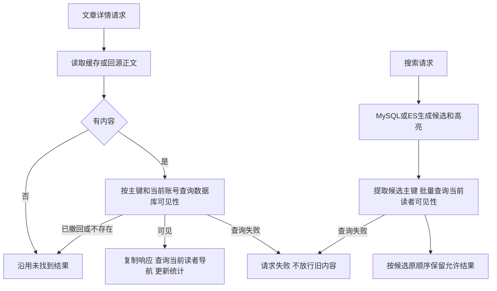

# 公开文章撤回读取校验设计

适用：Phase5 / BD-001。2026-10-17 加入详情/搜索发布与删除状态屏障，2026-10-18 接续私人分类/标签规则。范围限于下文列出的文章返回入口，不代表全站权限治理完成。

## 场景与权威事实

作者将已公开文章改成私密、草稿、回收或物理删除，数据库事务提交后，缓存或搜索索引仍可能包含原标题、正文和摘要。删缓存和异步删除索引都可能延迟或失败，公开读取因此不能仅相信派生副本。

本轮从现有 SQL 确认的规则是 `t_article.status=1` 且 `is_delete=0`。公开接口对所有调用者都使用该基础规则；即使是作者或现有特殊账号，也不能通过公开接口获取 SECRET/DRAFT/已删除内容。后台编辑接口保持原有权限与行为。

私人条件沿用现有文章筛选使用的分类 ID 60/61、标签“红红专属~”“猫猫出没”“w&p~”。统一规则为：命中任一私人分类或任一私人标签即限制；普通标签不抵消私人标签。匿名/普通账号只读非私人 PUBLIC/未删内容，原有两个指定邮箱账号可绕过私人标记，仍必须满足 PUBLIC/未删。此处复用既有个人博客规则，不新增角色、配置或通用权限平台。

账号由 ArticleAccessService 基于 Sa-Token 登录ID与数据库当前用户邮箱解析，每个相关请求重新确认；不存在、空邮箱或查询异常都按普通权限处理。邮箱常量值不写入文档。分类目录的“宝宝~”“不开心”名称隐藏暂保留为目录规则，没有无证据地当作新增文章权限标记；分类ID硬编码和标签按名称识别的局限仍保留，未来更换数据集或重命名需重新核对。

## 读取链路

`ArticleMapper.selectVisibleArticleIds(articleIds, privateAccess)` 只取调用方候选主键范围内、当前读者可见的公开文章ID，使用绑定参数，不加载正文；空集合/null 显式生成恒假条件，避免退化为全表状态查询。该 mapper 未启用二级缓存，调用入口没有额外开启读取事务。

详情在缓存/回源读取完成后校验，覆盖读取期间已经提交的撤回。校验拒绝时返回现有 `null` 未找到结果，不增加浏览量，也不返回标题、正文、AI摘要或导航。通过后复制独立 ArticleVO，再查询当前账号可见的前后篇并更新统计。无论缓存由谁预热、是否带有旧版导航，每次响应都覆盖 lastArticle/nextArticle；请求中的导航和统计字段不回写共享缓存。复制为浅拷贝，正文字符串/分类/标签只读复用，本链路不修改这些嵌套对象。

搜索在 `SearchStrategyContext` 统一过滤，避免仅修改ES而遗漏MySQL切换模式。每批候选只发一次状态SQL，不按结果逐条查库；过滤保持原排序和高亮，不尝试用新正文配旧高亮。过滤可能减少当前结果数量，本轮不补取候选或更改检索召回规则。

## 列表与共享 SQL 规则

ArticleMapper.xml 的 excludePrivateArticles 使用 NOT EXISTS 检查所有关联私人标签，并排除分类60/61；不会通过“存在一个普通标签”放行混合标签文章。articleAlias 只来自 include 的静态属性，不来自HTTP请求。privateAccess 仅由后端账号解析结果传入。

| 入口 | 筛选位置与结果 |
| --- | --- |
| 首页 | 普通查询在文章子查询中排除私人条件，之后才内存分页；指定账号查询仍要求PUBLIC/未删 |
| 详情 | 缓存/回源后查询当前分类和标签关系，拒绝时不返回内容、不计浏览量 |
| MySQL/ES搜索 | 共同出口批量确认当前分类/标签关系；移除MySQL策略内不一致的旧分类过滤 |
| 归档 | countVisibleArticles与selectArchiveList使用相同私人谓词，列表在LIMIT前筛选 |
| 推荐、上下篇 | 当前账号私人条件在LIMIT前生效，隐藏记录不占结果名额 |
| 分类/标签下文章 | 先按文章ID筛选与分页，再连接完整标签，避免多个标签关联挤占文章页容量 |

分类/标签条件列表保留原有必须存在分类和有效标签关联的要求，在文章分页前确认关联存在；没有调整孤立文章的数据修复规则。归档和数量是两个SQL，条件相同不代表并发修改期间共享同一数据库快照；没有为此增加长事务。

## 故障与产品反馈

数据库状态校验异常直接向上失败，不降级为“信任旧缓存/索引”。ES检索异常转为现有业务失败响应，消息为“搜索服务暂时不可用，请稍后重试”；HTTP与业务包装继续沿用 `GlobalExceptionHandler`，没有改成HTTP 503，也没有新增响应字段。

前台 Search.vue 保持列表为数组，分别承接等待、失败和真实无结果，失败后可重新搜索；关键词变化立即清除旧结果，迟到响应不能覆盖当前查询。只补本轮失败契约所需交互，没有改布局、高亮HTML协议或全站请求拦截器。

## 成本与一致性边界

- 返回有内容的详情使用一次主键可见性SQL；非空搜索候选使用一次批量可见性SQL，普通读者还会检查标签关系。登录用户增加当前邮箱查询，导航每次按当前账号查库。这是权限收回优先于只读缓存的明确取舍，没有性能提升声明或新增状态缓存。
- 承诺以状态SQL的数据库快照为准：撤回已提交并在该SQL中可见时，旧正文副本不能自行决定放行。账号资格以单独账号SQL读取时点为准，账号与文章状态不是原子快照；归档数量与列表也可能在两个SQL间发生变化。主从延迟、SQL快照之后才提交的撤回、已经发出的HTTP响应和浏览器已显示内容，不在严格阻断保证内。
- 状态仍为PUBLIC时的旧正文/旧AI摘要、撤回后又发布时缓存仍是更早内容、ES写入的跨实例乱序，仍需后续内容版本和缓存一致性设计。此次没有把读取屏障当成版本治理替代品。
- 首页、推荐、归档、条件文章列表和上下篇已使用上述私人文章规则；分类/标签目录元数据与聚合计数、热度榜管理输出、评论及其他派生入口不在10-18切片统一范围；独立问答检索已由下述10-19切片补充。不能据此宣称全站无私人信息泄露；HTTP已发出内容与既有客户端缓存也不受此保护。
- 搜索MySQL模式已有全量候选行为，本轮批量校验规模跟随候选数量；没有新增任意截断。实际数据量和延迟需要后续有证据时评估，不能凭空宣称高并发容量。

## 验证与接续

隔离验证覆盖旧缓存撤回、读取期间撤回、恢复发布、数据库失败、两种搜索模式共同过滤/顺序保持、ES失败与真实空结果。MyBatis实际解析新增动态SQL后，将其绑定SQL在内存SQLite执行状态矩阵；该证据不代表真实MySQL隔离级别或连接池行为。

2026-10-18 的私人规则切片完成本地实现与隔离验证，见[私人内容总结](../03-阶段总结/10-Phase5-私人内容可见性统一总结.md)。下一步补详情null/受限结果的必要前台承接、核实剩余公开派生入口，再按BD-002/003/005推进事务投递、旧版本回写和多实例缓存边界。真实MySQL/MQ/ES与浏览器时序仍待验收，没有部署或真实业务数据操作。

## 已有问答出口的接续保护（2026-10-19）

AiRagServiceImpl在把旧向量片段交给模型前，按metadata articleId复用同一当前可见性SQL；生成后再按当前账号复查全部usedIds。任一来源已不可见就丢弃整段答案与引用，不以“只删来源链接”替代答案保护。查询故障返回业务失败，引用URL由核验ID构造。详细时序、模型已收到内容无法追回的边界及隔离证据见[问答派生内容撤回读取约束](../05-AI体系/02-问答派生内容撤回读取约束.md)。其余目录/评论/旧版本边界保持，不扩大为全站权限完成。
