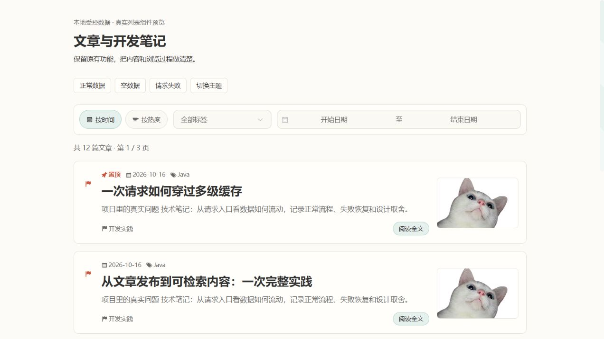
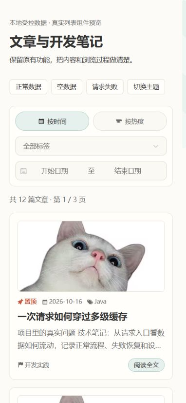

# Phase4-文章列表质量首轮总结

日期：2026-10-16。分支：`codex/blog-quality-daily`，基线 `46bfc23`。本轮目标是建立质量基线并实际改善现有首页文章列表，持续开发规则见 [日常约定](../00-项目总览/06-日常质量开发约定.md)。

## 本轮交付

- 核查三端核心内容流程并形成 18 项有源码依据的问题台账，区分确定缺陷、静态风险和待实测内容。
- 首页默认不设日期，避免旧日期显示与实际查询不一致；标签、排序、日期变化统一回到第一页，查询变更合并为一次请求，旧响应不能覆盖新结果。
- 日期结束日覆盖当天 23:59:59；提供清除筛选、文章数量及页码；保留现有分页、标签与阅读全文入口。
- 补齐加载、无文章、筛选无结果、失败重试、标签加载失败及重试，失败时保留筛选条件。
- 列表摘要从 Markdown 提取文本，以 Vue 插值显示，不再将摘要 HTML 直接挂到页面；剔除脚本/样式/图片等节点，缺少摘要提供诚实说明。
- 沿用米白/青绿和暗色主题，标题/摘要/操作层级更清楚；工具栏支持换行与手机单列，列表默认可见、支持减少动态效果，补齐键盘焦点和缺失封面呈现。
- 修复两级 README 的失效部署文档链接，接入新文档导航，准备每日质量升级接续。

## 修改文件

以下均相对 Git 根目录 `D:/IdeaProjects/blog`。

| 文件 | 职责及本轮变更 |
| --- | --- |
| shoka-blog/src/views/Article/ArticleItem.vue | 接入统一列表状态，补齐状态/筛选提示/安全文本摘要，局部展示及响应式修正 |
| shoka-blog/src/views/Article/useArticleFeed.ts | 单一查询监听、请求顺序保护、筛选重置、日期边界及事件解绑 |
| shoka-blog/src/views/Article/useArticleFeed.test.mjs | 以真实 Vue 响应式/生命周期和受控 API 检查列表核心行为，不访问业务库 |
| README.md、blog-springboot/README.md | 修复已核实的旧文档链接 |
| blog-springboot/docs/README.md | 接入台账、日常约定、计划、总结 |
| docs/00-项目总览/05-质量审查与升级台账.md | 保存检查覆盖、18 项问题、处理状态与下一轮入口 |
| docs/00-项目总览/06-日常质量开发约定.md | 固定边界、最小改动、风险适配验证和接续规则 |
| docs/02-阶段计划/03-Phase4-现有功能质量升级计划.md | 本轮范围、实现和验收约定 |
| docs/08-前端接入/assets/phase4-list-*.png | 本地受控数据下的真实组件截图，仅证明相应界面状态 |

## 验证记录

- `node src/views/Article/useArticleFeed.test.mjs`：通过。覆盖首次加载、筛选一次请求、页码重置、异步逆序、结束日 23:59:59、失败后重试、标签失败恢复和卸载事件解绑。使用真实 Vue watch/组件生命周期，API 为受控数据。
- `npm run build`：通过（含最终样式微调后的构建）。该命令只有 Vite 打包，不宣称 TypeScript 全量类型检查通过。
- 浏览器：真实 ArticleItem 与真实 Element Plus/Naive UI 控件，1280px 桌面和 390px 手机。确认正常列表、缺失封面、纯文本摘要、加载、空数据、请求失败和重试；确认手机筛选控件及工具栏不横向溢出；检查标签选择到无结果、清除筛选恢复和暗色主题。暗色标签框白底问题已通过局部控件样式修复。模拟数据和演示标题没有写入业务库。
- 生产构建仍有大块脚本和 CSS nesting 兼容警告；bg.jpg 为 5815.05 KiB，最大脚本约 2880.44 KiB。记录 BQ-017，未扩大范围调整依赖/压缩/构建策略。

截图：

## 未验证、原有改动及下一轮

未连接真实博客后端，未读真实数据库文章、登录后台、发布/删除/编辑线上文章或调用付费模型；没有部署、推送、合并主分支。现有 localhost:8080 的博客端点返回 404，不能作为服务就绪证据。

原有 `ArticleController.java` 构造器注入修改和根下未跟踪的 `homa-xxl-job/` 完整保留，不纳入本轮提交。Vite 自动生成的无关 d.ts 变化在完成时还原，临时预览入口和临时服务在验证后清理。

下一轮优先 BQ-008 可见性一致性核实/修复，其次 BQ-009/010 搜索正确性与高亮输出。BQ-011 阅读失败恢复、BQ-012 分类/标签翻页、BQ-013 发布重复提交、BQ-015 部署请求地址紧随其后。

提交记录：交付前仅提交本轮文件，提交标题 `fix: 完善文章列表体验并建立日常质量升级`，具体 SHA 以 Git 日志为准。自动化 `Blog 日常质量升级`（ID：blog）已创建为 ACTIVE，绑定本聊天，每天北京时间 10:00 执行，首次定时执行预计 2026-10-17 10:00。
