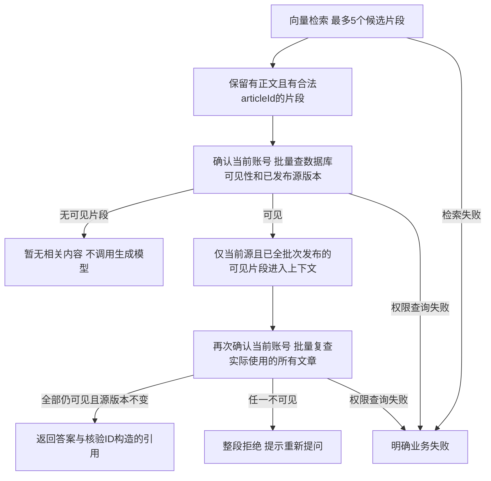

# 问答派生内容撤回读取约束

适用：2026-10-26更新，Phase5 / BD-001与Phase6 / Q2。这是已有博客问答出口对文章发布/撤回事实的读取保护，不扩展检索产品或模型能力。复用[公开读取校验设计](../01-架构设计/02-公开文章撤回读取校验设计.md)的私人账号与分类/标签规则。

## 为什么答案需要整体保护

当前入口为 AiController.chat → AiRagServiceImpl.chat → VectorStore.similaritySearch → ChatClient → AiChatResponseVO。AiArticleServiceImpl.processArticle/reindexHistory写入文章片段，并携带articleId、sourceVersion、title、url、chunkIndex等metadata；当前向量是派生副本，撤回文章不以物理清除所有向量为完成前提。

原实现直接拼接所有候选正文，引用也直接使用metadata标题/URL。即使详情和搜索已经拒绝私人或撤回文章，问答仍可能通过旧向量返回其正文派生答案。生成可能耗时，只有调用模型前的校验仍会遗漏生成期间的撤回。答案混合多个来源后无法可靠删去某一来源对应的文字，因此生成后任一实际使用来源不可见，都必须拒绝整个答案与引用。

## 两次校验与状态流

- 权限调用使用 ArticleMapper.selectVisibleAiArticles 与 ArticleAccessService，同时要求indexed_source_version=source_version；metadata的sourceVersion必须精确匹配当前数据库源身份。普通/匿名排除私人分类60/61或任一既有私人标签；两个指定账号仍不能读取SECRET/DRAFT/已删除文章。所有判断依据数据库当前事实，不使用metadata中的旧status、category或缓存身份。
- articleId必须为正的Java Integer范围内精确整数；兼容向量metadata返回的整数、整数浮点值及数字字符串。小数不截断、溢出不折返、NaN/非法字符串/布尔/缺少主键均排除，不从URL猜归属。生产器保留articleId；Q2新增sourceVersion。历史无归属或无版本片段会减少召回，需要授权回填，不能通过猜测放行。
- 候选主键去重后批量查一次，不逐片段查库；可见片段顺序保留，重复片段仍可提供上下文。同一文章引用按核验ID去重，URL固定为 `/article/{id}`，不照搬metadata URL；标题仍使用内部索引metadata，标题与正文同属作者source_version；旧源标题与正文一起拒绝。
- 第一次校验后的usedIds只包含实际进入上下文的文章。第二次重新解析账号并查usedIds，不复用首次资格；任一来源不再可见、源版本改变、缺少全批次发布凭据或无法查库，整段答案不进入成功响应。不自动重新检索/生成，避免隐性重试成本。

## 失败、恢复与前台契约

| 触发 | 结果 |
| --- | --- |
| 真无候选、无有效归属/正文或没有可见片段 | 原有成功响应：博客中暂无相关内容，sources为空；不调用生成模型 |
| 向量检索异常 | ServiceException：博客问答检索暂时不可用，请稍后重试 |
| 任一阶段可见性查询异常 | ServiceException：暂时无法确认参考文章访问权限，请稍后重试 |
| 生成期间撤回/删除/私人化或资格收回，二次SQL可见 | ServiceException：参考文章的内容或访问范围已变化，请重新提问；不返回答案与引用 |
| 权限或发布状态恢复后重新提问 | 只有仍与当前已发布源一致的候选可恢复；作者通过保存入口恢复会换源，旧源向量继续拒绝 |

GlobalExceptionHandler沿用现有Result.fail，HTTP仍为200、flag=false、data=null，没有新增响应字段或HTTP状态约定。前台专业问答原本已检查flag并提示msg；本轮在请求开始时清空旧answer/sources，避免失败后保留上轮答案造成当前结果错觉，用户保留问题可再次提交。自由对话与写作流接口不读取博客向量，本轮行为不改。

## 系统承诺与边界

承诺按校验SQL快照分阶段成立：首次SQL已可见的撤回/私人限制不进入此次生成上下文；第二次SQL已可见的来源或账号变化阻止该答案返回。账号查询与文章查询不是原子快照，数据库主从延迟也会影响观察时点。二次SQL后才发生的变化、已经发出的HTTP响应和浏览器已显示/复制内容不可能追回，不宣称零延迟撤回。

向量检索可能先调用Embedding模型生成查询向量；“无可见来源不调用生成模型”不等于没有任何模型调用成本。首次SQL之后才撤回时，上下文可能已经发给生成模型；第二次校验只能拒绝对读者返回，不能撤销模型供应商已收到的请求或已发生的费用。未增加自动重试。

本轮信任现有内部向量生产器将正文绑定到正确articleId；没有证明向量数据被篡改后仍能检测错误归属。Q2已补源身份、摘要条件发布、稳定向量身份及两次当前版本校验，详见[队列领域设计第8节](../01-架构设计/03-持久任务投递恢复与原子认领设计.md)。生成答案是否忠于上下文/是否幻觉、向量物理清理/旧点挤占topK、真实依赖可见性和失联RUNNING仍未闭环；消息投递恢复范围沿Q1记录。目录元数据、聚合、评论和其他派生接口继续独立列为待核实。

## 验证边界

使用模拟VectorStore、ChatClient、Mapper和账号解析，检查真实服务的提示词内容、批量查询、生成期间状态变化、拒绝及恢复；真实Controller/Service/异常处理器以standalone MockMvc执行一次拒绝输出契约。Vue实际setup由现有编译器和真实Vue renderer在Node中执行，接口响应受控。具体结果见[阶段总结](../03-阶段总结/11-Phase5-问答派生内容撤回保护总结.md)。

没有连接真实Qdrant/Embedding/LLM/MySQL/Redis/MQ/ES，没有启停或部署服务、写真实文章。隔离证据不代替真实服务、多实例、供应商日志或浏览器验收。

Q2验证补充：AiRagServiceImplTest最终16项通过，覆盖原撤回/资格/故障/HTTP契约以及旧/无版本、部分发布和生成中编辑；未接真实模型/向量库。迁移05未执行，旧向量读取收紧会降低召回，现有有限回填也可能调用付费Embedding，必须在授权环境另验。本次完整证据与恢复边界见[持续队列总结第7节](../03-阶段总结/14-Phase6-队列可靠性开发总结.md)。
